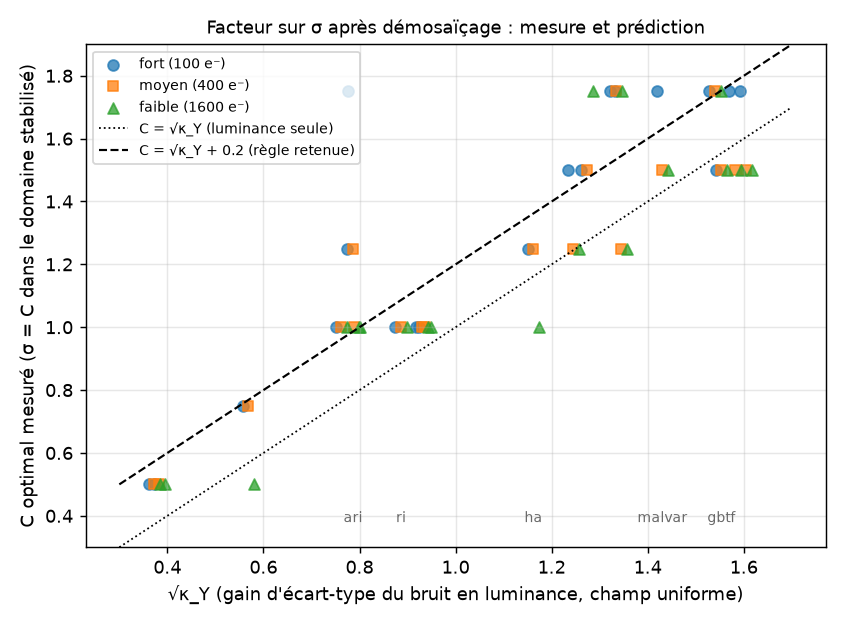
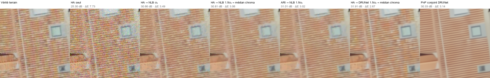
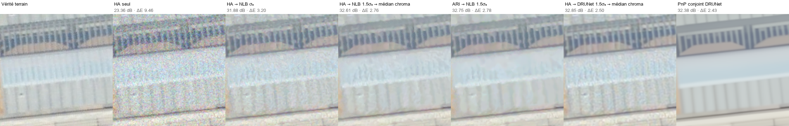

# Référence technique — eoqual-demosaicing

Détail de chaque méthode : principe, implémentation, limites connues.
Pour le catalogue résumé et l'installation, voir `README.md` ; pour
l'audit des licences, `THIRD_PARTY_LICENSES.md`.

## 1. Conventions

- Toutes les fonctions publiques ont la signature
  `xxx_demosaic(image: np.ndarray, ...) -> np.ndarray`.
- `image` est une image Bayer 2D (mosaïque brute, un seul canal). La
  sortie est une image RGB `(H, W, 3)`.
- Le motif de Bayer supporté (`pattern`) varie selon les méthodes — voir
  ci-dessous et le tableau de `README.md`. Les méthodes qui ne
  paramètrent pas `pattern` sont câblées en dur pour `RGGB` uniquement.

## 2. Interpolation générique

### 2.1 `interp_bilinear` / `interp_bicubic` / `interp_spline`

**Fichier** : `backends/interpolation/generic.py` (`interp_demosaic`)

Chaque canal R, G, B est extrait de la mosaïque puis interpolé
indépendamment par un filtre générique : noyau moyenneur
(`'bilinear'`), noyau gaussien séparable (`'bicubic'`), ou interpolation
par spline cubique (`'spline'`) — avec normalisation par le nombre
d'échantillons valides pour ignorer les pixels manquants dans la
convolution.

**Limites** : ignore la structure du motif de Bayer au-delà de
l'extraction par canal — pas de guidage inter-canal (contrairement à
`malvar` ou `ha`), donc plus sensible au moiré sur les hautes
fréquences.

## 3. OpenCV et colour-demosaicing

### 3.1 `opencv_bilinear` / `opencv_vng` / `opencv_ea`

**Fichier** : `backends/opencv/wrapper.py` (`opencv_demosaic`)

Enrobage direct de `cv2.cvtColor` avec les codes
`COLOR_BAYER_*2RGB[_VNG|_EA]` d'OpenCV : interpolation bilinéaire,
Variable Number of Gradients (VNG) et Edge-Aware (EA).

**Limites** : VNG requiert une image `uint8` ; les autres méthodes
`uint8`/`uint16` — conversion automatique avec avertissement sinon (voir
le code, non testé sur tous les cas de dépassement).

### 3.2 `colour_bilinear` / `colour_malvar2004` / `colour_menon2007`

**Fichier** : `backends/colour_science/wrapper.py` (`colour_science_demosaic`)

Enrobage du paquet [colour-demosaicing](https://github.com/colour-science/colour-demosaicing) :
bilinéaire, Malvar-He-Cutler (2004), et DDFAPD de Menon, Andriani &
Calvagno (2007) — filtrage directionnel avec décision a posteriori,
généralement la méthode la plus fidèle du socle sur des images
naturelles peu bruitées.

## 4. Implémentations propres du projet

### 4.1 `bilinear`

**Fichier** : `backends/bilinear/channelwise.py`

Interpolation bilinéaire canal par canal : noyau 5 points pour le vert,
9 points pour rouge/bleu, normalisés par le nombre d'échantillons
réellement sommés au bord de l'image.

### 4.2 `green_edge_based`

**Fichier** : `backends/green_edge_based/directional.py`

Le vert (canal le mieux échantillonné) est interpolé en choisissant,
pixel à pixel, entre un noyau horizontal/vertical/isotrope selon la
direction de plus faible contraste (gradient du vert brut). Rouge et
bleu sont interpolés sur leur différence au vert.

### 4.3 `malvar_bilateral`

**Fichier** : `backends/malvar_bilateral/bilateral.py`

Vert estimé par le noyau de Malvar-He-Cutler (identique à `malvar`),
puis rouge/bleu interpolés par un filtre bilatéral guidé par ce vert
(pondération spatiale + proximité radiométrique).

**Limites** : boucle Python par pixel manquant — coûteux sur de grandes
images. Motif RGGB uniquement.

### 4.4 `edge_aware` / `edge_aware_simplified`

**Fichier** : `backends/edge_aware/full.py`, `backends/edge_aware/simplified.py`

`edge_aware` : pour chaque pixel manquant, ne retient que les voisins
alignés avec la direction perpendiculaire au gradient local du vert
(le long d'un éventuel contour), pondérés par distance spatiale et
proximité radiométrique.

`edge_aware_simplified` : version vectorisable, fenêtre fixe 3×3,
pondération uniquement radiométrique (pas de terme spatial ni de
sélection directionnelle) — beaucoup plus rapide, qualité proche sur
images peu texturées.

**Limites** : `edge_aware` boucle en Python pur par pixel manquant (très
lent sur de grandes images) ; les deux sont RGGB uniquement.

### 4.5 `ahd`

**Fichier** : `backends/ahd/homogeneity.py`

Inspiré du principe général de Hirakawa & Parks (2005) — pas un portage
de l'algorithme original (qui compare deux directions candidates dans
un espace de couleur perceptuel). Le vert est interpolé
directionnellement, pondéré par le gradient local ; rouge/bleu sur leur
chrominance au vert.

**Limites** : approximation, pas l'algorithme AHD publié. Motif RGGB
uniquement.

### 4.6 `mrf`

**Fichier** : `backends/mrf/diffusion.py`

Inspiré des approches par champ de Markov — approxime l'énergie
(lissage de la chrominance sous contrainte edge-aware) par diffusion
itérative par points fixes, pas une véritable inférence MRF (belief
propagation, non praticable en Python pur).

**Limites** : approximation, 20 itérations par défaut (compromis
vitesse/qualité). Motif RGGB uniquement.

## 5. `malvar` — Malvar, He & Cutler

**Fichier** : `backends/malvar/he_cutler.py`
**Référence** : Malvar, H. S., He, L.-W., Cutler, R. (2004). "High-quality
linear interpolation for demosaicing of Bayer-patterned color images."
IEEE ICASSP.

Interpolation par noyaux 5×5 corrigés du gradient (figure 2 de
l'article) : un noyau pour le vert aux positions R/B, trois noyaux pour
rouge/bleu selon leur position relative (même ligne, même colonne,
diagonale). Adapté de `prysm.bayer` (licence MIT, voir
`THIRD_PARTY_LICENSES.md`).

**Limites** : motifs `RGGB`/`BGGR` uniquement.

## 6. Famille IPOL — `ha`, `ari`, `ri`, `gbtf`, `mlri`, `wmlri`

**Fichiers** : `backends/ha/ha.py`, `backends/ari/ari.py`, `backends/ri/ri.py`
**Référence principale** : Jin, Q., Guo, Y., Facciolo, G., Morel, J.-M.
(2021). "A Mathematical Analysis and Implementation of Residual
Interpolation Demosaicking Algorithms." Image Processing On Line.

### 6.1 `ha` — Hamilton & Adams (1997)

Interpolation directionnelle du vert (choix entre gradient horizontal
et vertical selon le contraste local), puis rouge/bleu par un schéma
similaire guidé par le vert. Référence historique : brevet US 5,629,734.

### 6.2 `ari` — Adaptive Residual Interpolation

Monno et al. (2016). Le vert est interpolé par un filtre guidé (guided
filter) adaptatif, puis rouge/bleu par résidu (différence au vert
lissée) en deux passes (diagonale, puis horizontale/verticale).

### 6.3 `ri` / `gbtf` / `mlri` / `wmlri` — Residual Interpolation et variantes

Un seul point d'entrée (`ri_demosaic`, paramètre `algorithm`) couvre
quatre articles :

- `gbtf` : Pekkucuksen & Altunbasak (2010), "Gradient Based Threshold
  Free Color Filter Array Interpolation," IEEE ICIP.
- `ri` : Monno et al. (2016), résiduel guidé simple.
- `mlri` / `wmlri` : Kiku et al. (2014/2016), résiduel minimisant le
  Laplacien (et sa variante pondérée).

**Limites communes à la famille IPOL** : `sigma` (régularisation du
filtre guidé) est ignoré par `gbtf` mais doit rester passé (valeur par
défaut `2.0`) ; pas de gestion native du bruit au-delà du filtre guidé
lui-même — pas de débruitage séparé.

## 7. `dlmmse` — LMMSE directionnelle (Zhang & Wu)

**Fichier** : `backends/dlmmse/zhang_wu.py`
**Référence** : Zhang, L., Wu, X. (2005). "Color demosaicking via
directional linear minimum mean square-error estimation." IEEE
Transactions on Image Processing, 14(12), 2167-2178.

Le vert est interpolé horizontalement et verticalement par un filtre
directionnel court (5 points), puis les deux estimations sont
fusionnées par pondération LMMSE : chaque direction est pondérée par la
variance de l'AUTRE direction (plus une direction est incertaine/
bruitée, moins elle pèse dans la fusion), estimée localement sur une
fenêtre de 9 pixels. Rouge et bleu sont ensuite obtenus par propagation
de leur différence au vert : diagonale entre positions rouge et bleu
(toujours diagonalement adjacentes dans un motif de Bayer), puis
axiale vers les positions vertes.

Réimplémentation vectorisée NumPy depuis les équations du code de
référence BSD de Pascal Getreuer (IPOL) — voir `backends/dlmmse/NOTICE.md`
pour le détail des deux points où cette réimplémentation diffère
volontairement du code source d'origine (gestion des bords, constante
de stabilisation numérique — équivalence vérifiée par comparaison
numérique, pas seulement par argument).

**Limites** : la variante « papier » de l'estimation de la moyenne
locale est implémentée (pas la variante alternative du code MATLAB de
référence de Zhang, très proche numériquement).

## 8. `cdm` — LDI-NAT (Zhang, Wu, Buades & Li)

**Fichier** : `backends/cdm/nat_cdm.py`
**Référence** : Zhang, L., Wu, X., Buades, A., Li, X. (2011). "Color
demosaicking by local directional interpolation and nonlocal adaptive
thresholding." Journal of Electronic Imaging, 20(2), 023016.

Pipeline en quatre étapes (Fig. 1 de l'article) :

1. **LDI** (Local Directional Interpolation) du vert : à chaque position
   rouge/bleue, la différence vert-rouge (ou vert-bleu) est estimée
   dans 4 directions sur une fenêtre compacte, fusionnées par pondération
   inversement proportionnelle au gradient directionnel.
2. **NAT** (Nonlocal Adaptive Thresholding) du vert : chaque position
   interpolée est raffinée par recherche des patchs les plus similaires
   (fenêtre 31×31, patchs 5×5, 100 candidats), projection sur leur propre
   base ACP (SVD locale) et seuillage doux — une alternative structurelle
   à la simple moyenne non locale (NLM), qui préserve mieux les contours.
3. **LDI diagonal** de rouge/bleu à l'aide du vert reconstruit (rouge et
   bleu sont toujours diagonalement adjacents dans un motif de Bayer),
   puis complétion axiale aux positions vertes.
4. **NAT** de rouge et bleu.

Réimplémentation depuis les équations et paramètres publiés (§2, §3.2)
— aucun code tiers repris. La complétion axiale (étape 3) distingue les
deux sous-types de pixel vert du motif de Bayer (axe « couleur cible
native » : lignes ou colonnes selon le sous-type) en appliquant la même
formule à l'image transposée pour l'un des deux — validé par comparaison
numérique sur les 4 motifs de Bayer (RMSE cohérente).

**Limites** : recherche de patchs + SVD par pixel manquant — nettement
plus coûteux que les autres méthodes du catalogue (non chronométré pour
être adapté aux grandes images sans optimisation). Le seuil NAT
(`t = 0.03 × g_Y`) utilise une formule de « gradient moyen des patchs »
non explicitée en détail dans l'article ; interprétée ici comme la
moyenne des différences successives absolues des patchs retenus.

## 9. `lslcd` — Démultiplexage luma-chroma (Dubois)

**Fichier** : `backends/lslcd/dubois.py`
**Référence** : Dubois, E. (2005). "Frequency-domain methods for
demosaicking of Bayer-sampled color images." IEEE Signal Processing
Letters, 12(12), 847-850 ; architecture non bruitée reprise de Jeon &
Dubois (2013), §III (voir §10 pour l'extension bruitée, non
implémentée).

Le signal Bayer est modélisé en fréquence comme une luminance en bande
de base plus deux chrominances modulées (une à la fréquence diagonale de
Nyquist, une aux deux fréquences axiales en opposition de phase). Le
démultiplexage démodule puis filtre passe-bas chaque porteuse ; les deux
estimées de chrominance axiale sont combinées par pondération inverse à
leur énergie locale ; la luminance s'obtient en retranchant les chromas
remodulées au signal brut. R, G, B sont enfin reconstruits par inversion
de la matrice luma-chrominance (`G = L+C1`, `R = (L-C1)+2C2`,
`B = (L-C1)-2C2`).

Réimplémentation depuis les équations publiées — aucun code tiers
repris. **Différences assumées avec l'article** : les filtres passe-bas
sont conçus ici par moindres carrés séparables (`scipy.signal.firls`,
11 points), pas jointement optimisés sur un jeu d'entraînement comme
dans l'article ; la combinaison adaptative des deux chromas axiales est
une heuristique par énergie locale, non spécifiée en détail dans
l'article. Les trois porteuses de modulation sont dérivées directement
des masques du motif de Bayer (pas d'une parité fixe supposée), pour
rester correctes quel que soit le motif — validé par comparaison
numérique sur les 4 motifs (RMSE identique à 0.0003 près).

**Limites** : qualité en retrait par rapport aux filtres publiés
(entraînés) de l'article — voir §10 pour l'extension bruitée non
implémentée.

## 10. Méthodes non implémentées

Voir `THIRD_PARTY_LICENSES.md` §3 : `LSLCD-NE` (extension bruitée de
`lslcd`, §9 — banc de filtres entraîné pour 11 niveaux de bruit non
reproduit) ; méthodes bloquées par une licence copyleft ou des droits
restreints (`RCD` : GPL-3.0 ; `SSD` : LGPLv3 + mention de brevets par
ses propres auteurs) ; ou simple citation bibliographique sans code
disponible (`AFD`, `AMaZE`, `CS`, `EAHD`, `HPHD`, `JCNN`, `LSSC`, `PPG`,
`RCNN`, `RTF`, `VCD`) ; ainsi que le démosaïçage multispectral/MSFA,
hors périmètre (motif de Bayer standard uniquement dans ce dépôt).

## 11. Démosaïçage et débruitage : bruit du capteur, choix de σ, choix du démosaïqueur

Question de départ : une chaîne « Hamilton-Adams (HA) puis NL-Bayes »
laisse des défauts chromatiques dans l'image finale. Faut-il changer
l'ordre des étapes, le niveau de bruit donné au débruiteur, le
démosaïqueur, ou passer à une méthode conjointe ? Ce chapitre pose le
modèle physique du bruit, calcule ce que le démosaïçage en fait, en
déduit le σ à donner au débruiteur, puis le vérifie et compare les
démosaïqueurs (qualité et temps de calcul) sur une orthophoto.

Le débruitage lui-même est traité dans la référence technique
d'**eoqual-denoising** (§4 : stabilisation de variance ; §10 : débruiter
une image démosaïquée, cas particulier du bruit coloré). Ce chapitre-ci
en est le pendant côté démosaïçage.

Reproduction (dépendances hors paquet : eoqual-denoising,
eoqual-metrics, tifffile, scikit-image ; deepinv et PyTorch pour les
chaînes DRUNet ; matplotlib pour la figure) :

```bash
python examples/joint_denoising_study.py capitole_2048_cog.tif --out sortie/        # §11.6
python examples/demosaicing_noise_benchmark.py capitole_2048_cog.tif --out sortie/  # §11.3, §11.7
```

Résultats bruts : `docs/figures/joint_denoising/results.json` (chaînes)
et `demosaicing_benchmark.json` (démosaïqueurs).

### 11.1 Ce que dit la littérature : Jin, Facciolo & Morel (2020)

Q. Jin, G. Facciolo, J.-M. Morel, « A Review of an Old Dilemma:
Demosaicking First, or Denoising First? », CVPR Workshops 2020
(arXiv 2004.11577).

- **Protocole** : bruit blanc gaussien ajouté à la mosaïque (σ₀ de 1 à
  60 sur 255), bases Imax et Kodak, 14 images brutes réelles SIDD (bruit
  blanchi par racine carrée) ; démosaïçage HA, GBTF, RI, MLRI, ARI, LSSC,
  RCNN ; débruitage CBM3D et nlBayes, adaptés à la mosaïque pour l'ordre
  « débruiter d'abord » (BM3D-CFA, ou image à 4 canaux en demi-résolution).
- **Bruit démosaïqué** : le démosaïçage concentre le bruit dans la
  luminance Y et le réduit en chrominance U, V, où il devient fortement
  corrélé spatialement — un bruit de basse fréquence. Les trois canaux
  sont corrélés (0.6 à 0.9).
- **Conclusion** : démosaïquer d'abord, puis débruiter avec un niveau de
  bruit **majoré**, ``σ = 1.5 σ₀`` (« DM&1.5DN »), justifié par la
  variance accrue de Y (facteur √3 ≈ 1.7 si les canaux étaient
  parfaitement corrélés). Pour HA + nlBayes à σ₀ = 20 : 28.17 dB
  (débruiter d'abord), 28.67 dB (σ = σ₀), **29.29 dB** (σ = 1.5 σ₀). Le
  réseau conjoint JCNN (Gharbi et al. 2016) ne fait guère mieux.

### 11.2 Modèle physique du bruit du capteur

**Physique.** Un photosite convertit un nombre aléatoire de photons en
photo-électrons ; ce comptage suit une loi de **Poisson** (bruit
photonique, ou de grenaille) : si ``λ`` électrons sont attendus, la
variance vaut aussi ``λ``. La chaîne de lecture ajoute un bruit
**gaussien** indépendant du signal (électronique de lecture,
quantification, courant d'obscurité), d'écart-type ``σ_r`` électrons.
La conversion en comptes numériques divise par le gain ``K`` (e⁻/DN).
Après soustraction du niveau d'obscurité et normalisation par la pleine
échelle ``S_max`` (DN), la luminance linéaire ``L ∈ [0, 1]`` d'un pixel
vérifie :

```
E[L] = λ / N_sat            avec N_sat = K · S_max  (électrons à pleine échelle)
var(L) = λ / N_sat² + σ_r² / N_sat²
       = a + b · L,          a = (σ_r / N_sat)²,   b = 1 / N_sat
```

- ``a`` est le **plancher** (bruit de lecture et d'obscurité, présent
  même dans le noir) ;
- ``b`` est la **pente** (bruit photonique, l'inverse du nombre
  d'électrons à pleine échelle) ;
- le bruit est **indépendant d'un photosite à l'autre** (pas de
  diaphonie) : spatialement blanc, mais **non stationnaire**, puisque
  son écart-type ``σ(L) = √(a + b·L)`` dépend de la luminance de chaque
  pixel.

C'est la droite de la courbe photon-transfert (PTC) : ``a`` et ``b`` se
mesurent par la PTC d'eoqual-measure, ou s'estiment sur l'image (le
modèle « var = a + b·L estimé en dehors » d'une chaîne existante est
exactement celui-ci).

**Théorie « en σ ».** Tout ce qui suit raisonne avec un écart-type, mais
un écart-type **fonction de la luminance**, ``σ(L) = √(a + b·L)``, et non
un σ unique. Deux façons de le donner à un débruiteur conçu pour un σ
unique :

- **stabilisation de variance** (transformée d'Anscombe généralisée,
  GAT) : ``f(L) = (2/b) · √(b·L + 3b²/8 + a)``. Par la méthode delta,
  ``var(f(L)) ≈ f'(L)² · var(L) = (a + b·L) / (a + b·L + 3b²/8) ≈ 1`` :
  le bruit devient d'écart-type **1, partout**. On débruite avec σ = 1
  (ou C, voir §11.4), puis on applique l'inverse exacte non biaisée
  (Mäkitalo & Foi 2013). Dans eoqual-denoising :
  ``generalized_anscombe(L, gain=1/b, read_noise_dn=√a)`` ;
- **σ global équivalent** : ``σ₀ = √(a + b·L̄)`` (valeur quadratique
  moyenne sur l'image). Plus simple, mais trop fort dans les zones
  sombres et trop faible dans les zones claires.

### 11.3 Ce que le démosaïçage fait du bruit

**Modèle linéaire local.** Autour d'un pixel ``p``, un démosaïqueur
estime chaque canal ``c`` comme une combinaison des valeurs voisines de
la mosaïque, ``x̂_c(p) = Σ_q w_{c,p}(q) · y(q)``, avec ``Σ_q w = 1`` (une
zone uniforme reste uniforme). Les méthodes adaptatives (HA, ARI...)
choisissent ces poids selon les données ; le modèle reste valable
localement. Le bruit de sortie est la même combinaison des bruits
d'entrée, indépendants :

```
var ε̂_c(p)            = Σ_q w_{c,p}(q)² · σ²(L_q)  ≈  σ²(L_p) · Σ_q w_{c,p}(q)²     (zone homogène)
cov(ε̂_c(p), ε̂_c'(p')) = Σ_q w_{c,p}(q) · w_{c',p'}(q) · σ²(L_q)
```

Trois conséquences :

1. **Chaque canal est moins bruité** qu'un photosite : ``Σ w² ≤ 1``
   quand ``Σ w = 1`` (moyenne de plusieurs mesures) ; l'égalité n'a lieu
   qu'au pixel mesuré.
2. **Le bruit devient corrélé** entre pixels voisins et entre canaux :
   des poids partagés (``w_{c,p}`` et ``w_{c',p'}`` utilisent les mêmes
   photosites) créent des covariances.
3. **La structure couleur change.** Dans la base orthonormée
   ``Y = (R+G+B)/√3``, ``U = (R−G)/√2``, ``V = (R+G−2B)/√6``, la
   variance de Y est ``(1/3) Σ_{c,c'} cov(ε̂_c, ε̂_c')`` : des canaux
   corrélés positivement l'**augmentent** (jusqu'à ×3 si les trois canaux
   étaient identiques), tandis que U et V, faits de différences, la
   **diminuent** — mais ce qui reste en U, V est de basse fréquence (taches
   colorées).

On note ``κ_Y, κ_U, κ_V`` le rapport des variances après / avant
démosaïçage. Le modèle de bruit devient, en zone homogène,
``var_Y(L) ≈ κ_Y · (a + b·L)`` : la forme affine est conservée, avec un
coefficient propre à chaque démosaïqueur. Mesure (`demosaicing_noise_benchmark.py`) :
bruit blanc σ = 20/255 sur une mosaïque uniforme (L = 0.5), corrélation
avec le voisin horizontal :

| Méthode | κ_Y | κ_U | κ_V | corr. Y | corr. U | √κ_Y | C = √κ_Y + 0.2 |
|---|---|---|---|---|---|---|---|
| `interp_bilinear` | 0.14 | 0.13 | 0.16 | 0.80 | 0.80 | 0.37 | 0.57 |
| `interp_bicubic` | 0.15 | 0.13 | 0.17 | 0.85 | 0.85 | 0.38 | 0.58 |
| `interp_spline` | 0.32 | 0.31 | 0.34 | 0.68 | 0.66 | 0.57 | 0.77 |
| `colour_bilinear` | 0.58 | 0.59 | 0.58 | 0.57 | 0.53 | 0.76 | 0.96 |
| `bilinear` | 0.58 | 0.59 | 0.58 | 0.57 | 0.53 | 0.76 | 0.96 |
| `opencv_bilinear` | 0.58 | 0.59 | 0.58 | 0.57 | 0.53 | 0.76 | 0.96 |
| `ari` | 0.62 | 0.62 | 0.64 | 0.52 | 0.51 | 0.79 | 0.99 |
| `opencv_ea` | 0.62 | 0.66 | 0.60 | 0.53 | 0.48 | 0.79 | 0.99 |
| `edge_aware_simplified` | 0.72 | 0.77 | 0.69 | 0.39 | 0.31 | 0.85 | 1.05 |
| `edge_aware` | 0.73 | 0.80 | 0.66 | 0.06 | -0.03 | 0.85 | 1.05 |
| `ri` | 0.79 | 0.52 | 0.55 | 0.48 | 0.45 | 0.89 | 1.09 |
| `mlri` | 0.87 | 0.46 | 0.50 | 0.44 | 0.49 | 0.93 | 1.13 |
| `wmlri` | 0.88 | 0.45 | 0.49 | 0.43 | 0.48 | 0.94 | 1.14 |
| `cdm` | 1.04 | 0.58 | 0.69 | 0.17 | 0.22 | 1.02 | 1.22 |
| `malvar_bilateral` | 1.29 | 0.22 | 0.24 | 0.21 | 0.51 | 1.14 | 1.34 |
| `ha` | 1.35 | 0.40 | 0.46 | 0.29 | 0.60 | 1.16 | 1.36 |
| `mrf` | 1.55 | 0.29 | 0.41 | 0.29 | 0.64 | 1.25 | 1.45 |
| `ahd` | 1.62 | 0.38 | 0.55 | 0.29 | 0.69 | 1.27 | 1.47 |
| `green_edge_based` | 1.78 | 0.43 | 0.63 | 0.24 | 0.69 | 1.33 | 1.53 |
| `opencv_vng` | 1.81 | 0.22 | 0.26 | 0.18 | 0.73 | 1.34 | 1.54 |
| `colour_malvar2004` | 2.05 | 0.33 | 0.38 | 0.26 | 0.68 | 1.43 | 1.63 |
| `malvar` | 2.05 | 0.33 | 0.38 | 0.26 | 0.68 | 1.43 | 1.63 |
| `lslcd` | 2.37 | 0.30 | 0.36 | 0.11 | 0.78 | 1.54 | 1.74 |
| `gbtf` | 2.41 | 0.11 | 0.14 | 0.13 | 0.85 | 1.55 | 1.75 |
| `colour_menon2007` | 2.50 | 0.20 | 0.26 | 0.11 | 0.80 | 1.58 | 1.78 |
| `dlmmse` | 2.58 | 0.06 | 0.09 | 0.09 | 0.85 | 1.60 | 1.80 |

Lecture : les interpolations séparables (bilinéaire, bicubique) lissent
le bruit (κ ≈ 0.15, très corrélé) ; les méthodes directionnelles et à
différences de couleur (HA, AHD, Malvar, GBTF, DLMMSE) concentrent le
bruit en luminance (κ_Y de 1.35 à 2.6) et laissent une chrominance faible
mais très corrélée (0.6 à 0.85). Les méthodes à **filtrage guidé
adaptatif** (RI, MLRI, ARI) lissent fortement un champ uniforme
(κ_Y ≈ 0.6 à 0.9) ; sur une scène texturée elles transmettent davantage
de bruit, si bien que leur κ mesuré sur champ uniforme est un minorant —
d'où l'écart avec Jin et al., qui mesurent sur du bruit pur (κ_Y ≈ 1.8
pour RI).

### 11.4 Quel σ donner au débruiteur

Les débruiteurs couleur (NL-Bayes en mode Y₀U₀V₀, CBM3D) passent en
luminance/chrominance et règlent leur étape principale sur le niveau de
bruit de **Y**. Après démosaïçage, celui-ci vaut ``√κ_Y · σ(L)`` :

1. **stabiliser** l'image démosaïquée avec les paramètres du capteur
   ``(a, b)`` — le bruit vaut alors ``√κ_c`` (et non 1) dans le domaine
   stabilisé ;
2. **débruiter avec σ = C**, ``C = √κ_Y + 0.2`` ;
3. **inverser** la stabilisation.

Sans stabilisation, donner ``σ = C · σ₀`` avec ``σ₀ = √(a + b·L̄)``.

Le terme ``√κ_Y`` vient de la théorie (luminance) ; le **+0.2** est
empirique : il compense le bruit de chrominance basse fréquence, que le
débruiteur voit comme du signal, et que seul un σ un peu plus fort
efface. Validation sur 19 démosaïqueurs × 3 niveaux de bruit × 4 zones
(§11.7), C balayé de 0.5 à 1.75 : corrélation de 0.88 entre l'optimum
mesuré et √κ_Y, et perte par rapport à l'optimum de chaque cas :

| Règle | bruit fort (100 e⁻) | moyen (400 e⁻) | faible (1600 e⁻) |
|---|---|---|---|
| C = 1 (σ du capteur, sans majoration) | 1.12 dB (max 3.44) | 0.47 (max 1.48) | 0.22 (max 1.14) |
| C = 1.25 fixe | 0.63 (max 2.25) | 0.20 (max 0.57) | 0.13 (max 0.74) |
| C = 1.5 fixe (Jin et al.) | 0.31 (max 1.16) | 0.18 (max 0.78) | 0.15 (max 0.53) |
| C = √κ_Y | 0.33 (max 1.19) | 0.11 (max 0.65) | 0.06 (max 0.25) |
| **C = √κ_Y + 0.2** | **0.08 (max 0.39)** | **0.04 (max 0.16)** | **0.05 (max 0.22)** |



*Points sur la grille 0.5 à 1.75 (les optima à 1.75 peuvent être plus
hauts). Pour HA, √κ_Y + 0.2 = 1.36 ; le facteur 1.5 de Jin et al.
correspond à un démosaïqueur de κ_Y ≈ 1.7 (RI sur bruit pur, dans leur
mesure).*

**Piège : estimer σ après le démosaïçage.** L'estimateur usuel
(Donoho-Johnstone : médiane de la sous-bande d'ondelettes diagonale la
plus fine) ne voit que les hautes fréquences du bruit, que le démosaïçage
a atténuées. Mesure, zone « tuiles » :

| | σ₀ vrai | estimé après HA | estimé sur les 4 sous-plans de la mosaïque |
|---|---|---|---|
| 100 e⁻ | 0.061 | 0.031 (×0.50) | 0.061 (×1.00) |
| 400 e⁻ | 0.029 | 0.016 (×0.56) | 0.034 (×1.15) |

Un σ estimé après HA vaut la **moitié** du vrai : NL-Bayes sous-débruite
et laisse des taches colorées (28.2 dB / ΔE 5.5 contre 30.9 dB / ΔE 3.3
avec le σ de la mosaïque majoré de 25 %, à 100 e⁻). Le σ — ou ``(a, b)``
— se mesure **sur la mosaïque** (sous-plans R, G1, G2, B, où le bruit est
encore blanc) ou sur le capteur (PTC).

### 11.5 Protocole des études

- **Scène** : extrait 2048×2048 de l'**Orthophotoplan 2024** de Toulouse
  Métropole (secteur du Capitole, 5 cm, août 2024 ; © Toulouse Métropole,
  Licence Ouverte v2.0 Etalab), **supposé sans bruit**, linéarisé par
  l'inverse du gamma sRGB. Quatre zones de 512×512 : *tuiles*,
  *végétation*, *pavés*, *verrière*.
- **Acquisition simulée** : mosaïque RGGB, bruit ``var = a + b·L`` avec
  ``b = 1/N``, ``a = (2/N)²`` pour N = 100, 400, 1600 électrons à pleine
  échelle et 2 e⁻ de bruit de lecture (bruit fort, moyen, faible ;
  σ₀ = 0.056, 0.027, 0.013 de la dynamique).
- **Scores** dans l'espace d'affichage (sRGB) : **CPSNR** (dB) et
  **ΔE2000** moyen (erreur de couleur perçue ; < 1 imperceptible,
  2 à 3 visible), moyennes sur les quatre zones.
- **Débruiteurs** : NL-Bayes couleur d'eoqual-denoising (mode Y₀U₀V₀),
  DRUNet couleur de deepinv (poids BSD-3-Clause).

### 11.6 Chaînes démosaïçage + débruitage

`joint_denoising_study.py`. NL-Bayes avec le σ global équivalent σ₀
(ou C·σ₀), sauf « GAT » (stabilisation avec ``(a, b)`` après le
démosaïçage). CPSNR (dB) / ΔE2000 :

| Chaîne | 100 e⁻ (fort) | 400 e⁻ (moyen) | 1600 e⁻ (faible) |
|---|---|---|---|
| HA seul (aucun débruitage) | 24.12 / 8.63 | 30.58 / 4.39 | 34.68 / 2.56 |
| *HA sans bruit (plancher)* | *37.47 / 1.42* | *37.47 / 1.42* | *37.47 / 1.42* |
| *ARI sans bruit (plancher)* | *41.53 / 0.98* | *41.53 / 0.98* | *41.53 / 0.98* |
| **HA → NLB σ₀** (chaîne de départ) | 31.20 / 3.27 | 33.91 / 2.35 | 35.66 / 1.88 |
| HA → NLB 1.5σ₀ (Jin et al.) | 31.62 / 2.97 | 34.00 / 2.22 | 35.49 / 1.83 |
| HA → GAT → NLB 1.5 | 31.67 / 2.97 | 34.13 / 2.20 | 35.68 / 1.80 |
| GAT → NLB (mosaïque) → HA (débruiter d'abord) | 30.26 / 3.44 | 33.14 / 2.55 | 35.38 / 1.98 |
| HA → NLB σ₀ → médian chroma | 31.24 / 3.08 | 34.14 / 2.17 | 36.07 / 1.69 |
| HA → NLB 1.5σ₀ → médian chroma | 31.73 / 2.86 | 34.26 / 2.11 | 35.91 / 1.69 |
| ARI → NLB σ₀ | 31.56 / 3.12 | 35.04 / 2.06 | 37.63 / 1.56 |
| ARI → NLB 1.5σ₀ | 31.84 / 2.87 | 34.86 / 2.03 | 37.31 / 1.58 |
| PnP conjoint, a priori NLB | 31.05 / 3.04 | 33.38 / 2.42 | 34.79 / 2.09 |
| HA → DRUNet 1.5σ₀ | 32.27 / 2.55 | 34.39 / 2.02 | 35.91 / 1.70 |
| HA → DRUNet 1.5σ₀ → médian chroma | 32.30 / 2.53 | 34.47 / 1.99 | 36.09 / 1.64 |
| **ARI → DRUNet 1.5σ₀** | **32.76 / 2.47** | **35.51 / 1.87** | **37.83 / 1.50** |
| PnP conjoint, a priori DRUNet | 31.08 / 2.79 | 34.03 / 2.15 | 35.61 / 1.74 |

« Médian chroma » : médian 3×3 sur R−G et B−G, G inchangé (Freeman
1988). « PnP conjoint » : éclatement semi-quadratique sur
``y = M·x + bruit`` (``M`` : échantillonnage RGGB), attache aux données
pondérée par ``1 / (a + b·y)``, débruiteur couleur comme a priori, niveau
décroissant (λ = 0.1, de 1.7σ₀ à 0.5σ₀, 8 itérations pour NLB ;
λ = 0.23, de 3.4σ₀ à 0.7σ₀, 12 itérations pour DRUNet), à la manière de
FlexISP (Heide et al. 2014).





*Vignettes 160×160 agrandies ×2 (100 e⁻), scores de la zone entière.
Source : Orthophotoplan 2024, © Toulouse Métropole, Licence Ouverte v2.0.
Autre zone : `docs/figures/joint_denoising/vignettes_paves_100e.png`.*

### 11.7 Comparaison des démosaïqueurs : qualité et temps de calcul

`demosaicing_noise_benchmark.py`. Bruit ``var = a + b·L``, GAT avec
``(a, b)`` après le démosaïçage, NL-Bayes avec σ = C, **C optimal** de
chaque cas (la règle du §11.4 en est à 0.1 dB près). Temps : démosaïçage
seul d'une image 2048×2048 (4 Mpx), CPU Apple Silicon, meilleur de deux
passages (NL-Bayes ajoute ≈ 31 s pour 4 Mpx, quel que soit le
démosaïqueur). CPSNR (dB) / ΔE2000, classés par qualité à bruit moyen :

| Méthode | Temps 4 Mpx (s) | vs HA | Sans bruit | 100 e⁻ | 400 e⁻ | 1600 e⁻ | C optimal |
|---|---|---|---|---|---|---|---|
| `ari` | 66.12 | ×137.9 | 41.53 / 0.98 | 31.75 / 3.02 | 35.35 / 1.99 | 37.93 / 1.52 | 1.25/1.25/1.0 |
| `gbtf` | 0.41 | ×0.8 | 39.86 / 1.04 | 32.31 / 2.67 | 35.21 / 1.99 | 37.52 / 1.55 | 1.5/1.5/1.5 |
| `malvar` | 0.14 | ×0.3 | 39.64 / 1.19 | 31.84 / 2.87 | 35.18 / 2.04 | 37.46 / 1.59 | 1.75/1.5/1.5 |
| `mrf` | 2.97 | ×6.2 | 38.90 / 1.38 | 31.96 / 2.87 | 35.10 / 2.16 | 37.11 / 1.76 | 1.5/1.25/1.25 |
| `opencv_vng` | 0.06 | ×0.1 | 40.07 / 1.35 | 23.17 / 5.39 | 35.02 / 2.07 | 37.59 / 1.66 | 1.75/1.25/1.25 |
| `colour_menon2007` | 1.43 | ×3.0 | 40.76 / 1.06 | 31.84 / 2.86 | 34.98 / 2.07 | 37.53 / 1.59 | 1.75/1.5/1.5 |
| `dlmmse` | 0.51 | ×1.1 | 38.76 / 1.32 | 32.07 / 2.71 | 34.81 / 2.08 | 36.83 / 1.72 | 1.75/1.5/1.5 |
| `green_edge_based` | 0.30 | ×0.6 | 37.61 / 1.55 | 31.48 / 3.10 | 34.62 / 2.21 | 36.41 / 1.83 | 1.75/1.75/1.75 |
| `ahd` | 0.32 | ×0.7 | 36.53 / 1.75 | 31.88 / 3.12 | 34.55 / 2.36 | 35.91 / 2.02 | 1.5/1.5/1.75 |
| `ha` | 0.48 | ×1.0 | 37.47 / 1.42 | 31.56 / 3.11 | 34.14 / 2.23 | 35.79 / 1.86 | 1.25/1.25/1.0 |
| `wmlri` | 3.29 | ×6.9 | 36.88 / 1.81 | 31.34 / 3.20 | 34.11 / 2.36 | 35.58 / 2.03 | 1.0/1.0/1.0 |
| `lslcd` | 1.69 | ×3.5 | 35.27 / 1.70 | 31.34 / 3.07 | 34.09 / 2.18 | 35.37 / 1.79 | 1.75/1.75/1.75 |
| `mlri` | 2.03 | ×4.2 | 36.74 / 1.83 | 31.32 / 3.22 | 34.04 / 2.38 | 35.48 / 2.06 | 1.0/1.0/1.0 |
| `ri` | 2.04 | ×4.2 | 36.44 / 1.88 | 31.13 / 3.28 | 33.84 / 2.43 | 35.25 / 2.10 | 1.0/1.0/1.0 |
| `bilinear` | 0.24 | ×0.5 | 35.93 / 1.80 | 30.98 / 3.33 | 33.58 / 2.43 | 34.93 / 2.05 | 1.0/1.0/1.0 |
| `interp_spline` | 0.76 | ×1.6 | 34.24 / 1.54 | 29.82 / 3.49 | 32.47 / 2.40 | 33.55 / 2.07 | 0.75/0.75/0.5 |
| `opencv_ea` | 0.03 | ×0.1 | 35.81 / 2.02 | 22.32 / 6.82 | 32.26 / 2.62 | 34.81 / 2.21 | 1.75/1.0/1.0 |
| `interp_bicubic` | 0.58 | ×1.2 | 31.05 / 1.84 | 28.82 / 3.65 | 30.36 / 2.61 | 30.83 / 2.16 | 0.5/0.5/0.5 |
| `interp_bilinear` | 0.56 | ×1.2 | 30.07 / 2.11 | 28.46 / 3.59 | 29.66 / 2.69 | 29.97 / 2.33 | 0.5/0.5/0.5 |

Méthodes évaluées sans bruit seulement :

| Méthode | Temps 4 Mpx (s) | vs HA | Sans bruit | Raison |
|---|---|---|---|---|
| `opencv_bilinear` | 0.03 | ×0.1 | 35.86 / 1.80 | même noyau que `bilinear` (κ identiques), bords différents |
| `colour_bilinear` | 0.14 | ×0.3 | 34.00 / 1.91 | même noyau que `bilinear` (κ identiques), bords différents |
| `colour_malvar2004` | 0.27 | ×0.6 | 39.64 / 1.19 | même résultat que `malvar` |
| `malvar_bilateral` | 185.52 | ×387 | 37.21 / 2.10 | trop lent pour l'évaluation avec bruit |
| `edge_aware` | 316.18 | ×659 | 31.03 / 3.78 | trop lent pour l'évaluation avec bruit |
| `edge_aware_simplified` | 91.86 | ×192 | 33.81 / 2.48 | trop lent pour l'évaluation avec bruit |
| `cdm` | 1939.84 | ×4046 | 30.91 / 3.72 | trop lent pour l'évaluation avec bruit |

Lecture :

- **`gbtf`** (Pekkucuksen & Altunbasak 2010) est le meilleur compromis :
  **aussi rapide que HA** (0.41 s contre 0.48 s), meilleur à tous les
  niveaux de bruit (+0.75 / +1.07 / +1.73 dB à C optimal, ΔE −11 à −16 %),
  meilleur que tout le catalogue à bruit fort.
- **`ari`** est le meilleur à bruit moyen et faible (+1.2 / +2.1 dB sur
  HA) et sans bruit (41.5 dB), mais **138 fois plus lent** (66 s pour
  4 Mpx) et pas meilleur que GBTF à bruit fort.
- **`malvar`** est le plus rapide des bons (0.14 s, 3 fois plus rapide
  que HA), à 0.1 à 0.5 dB de GBTF.
- `mrf`, `colour_menon2007`, `opencv_vng`, `dlmmse` : intermédiaires ;
  **`opencv_vng` et `opencv_ea` s'effondrent à bruit fort** (22 à 23 dB) :
  leurs décisions de direction sont piégées par le bruit.
- Les interpolations séparables (`interp_*`, `bilinear`) et les méthodes
  lentes sans gain (`cdm`, `edge_aware*`) ne sont pas à retenir ici.

### 11.8 Ce que les études confirment, nuancent ou contredisent

1. **Débruiter après démosaïquer — confirmé.** Débruiter la mosaïque
   d'abord perd 0.3 à 0.9 dB : la demi-résolution des quatre sous-plans
   perd les détails fins.
2. **Majorer σ — confirmé et précisé.** Le bon facteur n'est pas 1.5 en
   général mais **√κ_Y + 0.2**, propre à chaque démosaïqueur (1.36 pour
   HA, 1.75 pour GBTF, 1.0 à 1.25 pour la famille RI) ; il est aussi
   plus fort pour DRUNet (1.5 à 1.75 avec HA).
3. **Le démosaïqueur compte — contredit.** L'article trouve des écarts
   négligeables une fois σ adapté, à bruit fort. Ici, à bruit moyen et
   faible, l'écart atteint 2 dB : une part des défauts de la chaîne de
   départ vient de HA lui-même (plancher 37.5 dB, ΔE 1.42), dont les
   fausses couleurs sur les contours survivent au débruitage.
4. **Le médian chroma** corrige surtout les fausses couleurs de
   démosaïçage (sans bruit : +0.7 dB pour HA, +4.3 à +4.5 dB pour RI et
   MLRI, rien pour ARI) ; après débruitage, 0 à 0.4 dB. Taille 3×3 (un
   médian 5×5 dégrade la végétation).
5. **La stabilisation de variance** gagne 0.05 à 0.2 dB sur le σ global
   équivalent dans cette plage de flux ; davantage attendu sur une scène
   à fort contraste (ombres profondes et zones claires).
6. **Le Plug-and-Play conjoint ne gagne pas** (0.2 à 0.9 dB sous la
   chaîne séquentielle NL-Bayes, 1.5 à 2.2 dB sous ARI → DRUNet) et
   aplatit les textures ; comme JCNN dans l'article, l'approche conjointe
   n'est pas la priorité.

### 11.9 Recommandations

Dans tous les cas : **démosaïquer, puis stabiliser avec ``(a, b)``
mesurés sur la mosaïque ou le capteur, puis débruiter avec
σ = √κ_Y + 0.2** (κ_Y du §11.3), puis inverser la stabilisation.

| Contrainte | Chaîne (C = √κ_Y + 0.2) | Gain (100 / 400 / 1600 e⁻) | ΔE | Temps démosaïçage 4 Mpx |
|---|---|---|---|---|
| remplacement direct de HA | **`gbtf` → GAT → NLB, C = 1.75** | +1.2 / +1.1 / +1.6 dB | −14 à −19 % | 0.4 s |
| qualité maximale sans réseau, bruit moyen à faible | `ari` → GAT → NLB, C = 1.0 | +0.5 / +1.2 / +2.1 dB | −5 à −18 % | 66 s |
| vitesse maximale | `malvar` → GAT → NLB, C = 1.6 | +0.8 / +1.2 / +1.7 dB | −12 à −14 % | 0.14 s |
| HA imposé | HA → GAT → NLB, C = 1.36 (+ médian chroma 3×3) | +0.6 / +0.1 / −0.1 dB | −3 à −7 % | 0.5 s |
| PyTorch disponible | `ari` → DRUNet 1.5σ₀ | +1.6 / +1.6 / +2.2 dB (§11.6) | −20 à −24 % | 66 s |

Gains par rapport à HA → GAT → NLB avec σ = 1 (le σ du capteur sans
majoration), même bruit et mêmes zones (§11.7) ; dernière ligne : par
rapport à HA → NLB σ₀ (§11.6).

**Répartition entre bibliothèques.** Le démosaïçage (eoqual-demosaicing)
et le débruitage (eoqual-denoising) restent séparés : une image n'est
pas toujours démosaïquée, et un débruiteur sert à bien d'autres images.
Ce qui relie les deux est une **information** — κ_Y du démosaïqueur
utilisé, et ``(a, b)`` du capteur — plutôt qu'un traitement. Deux options,
non tranchées :

- **enchaîner** les deux appels en documentant la recette (ce chapitre,
  et eoqual-denoising §10) : aucune dépendance entre bibliothèques ;
- **exposer κ_Y** dans le registre d'eoqual-demosaicing (champ de
  `METHODS_CONFIGS`, mesuré une fois pour toutes), et laisser à
  eoqual-denoising la stabilisation et le facteur C (paramètre
  ``noise_gain`` par exemple) : chaque bibliothèque garde son rôle, la
  chaîne s'écrit en trois lignes.

### 11.10 Limites

- L'orthophoto est un produit déjà traité (démosaïqué, rehaussé,
  compressé) : « sans bruit » est une hypothèse, et sa linéarisation par
  le gamma sRGB une approximation. Les planchers absolus des
  démosaïqueurs dépendent de ce traitement préalable ; le classement est
  plus robuste que les valeurs.
- Un seul capteur simulé (RGGB, pixels indépendants, sans diaphonie ni
  non-uniformité de réponse), quatre zones d'une même scène.
- κ est mesuré sur un champ uniforme : un minorant pour les méthodes
  adaptatives sur scène texturée (d'où le terme +0.2, et l'écart de la
  famille RI).
- ΔE2000 calculé en supposant un sRGB D65 ; CPSNR et ΔE mesurent des
  erreurs moyennes, pas l'aspect des artefacts locaux, d'où les vignettes.
- Paramètres du Plug-and-Play réglés sur une zone (tuiles, 400 e⁻).


### 11.11 Mode opératoire sur données réelles : Hamilton-Adams et GBTF

Pour vérifier sur ses propres images ce que prévoit l'étude, et choisir
entre HA et GBTF. Exemple exécutable : `examples/real_data_protocol.py` ;
tracés : notebook `examples/demosaicing_noise.ipynb` (Plotly).

**Valeurs à tester** (σ = C dans le domaine stabilisé) :

| Démosaïqueur | κ_Y | C de la règle | Valeurs balayées par défaut |
|---|---|---|---|
| `ha` | 1.35 | **1.36** | 1.0 (σ du capteur), 1.16 (√κ_Y), 1.36, 1.5 |
| `gbtf` | 2.41 | **1.75** | 1.25, 1.55 (√κ_Y), 1.75, 2.0 |

**Étapes.**

0. **Unités.** Tout se fait en luminance linéaire normalisée, avant
   balance des blancs et gamma : ``L = (DN − offset) / S``,
   ``S = DN_max − offset``. Un modèle de bruit donné en DN,
   ``var(DN) = a_DN + b_DN · (DN − offset)``, se convertit en
   ``a = a_DN / S²`` et ``b = b_DN / S``. ``(a, b)`` doivent avoir été
   estimés **sur la mosaïque brute** (ou par la PTC) — sur une image
   démosaïquée, ils seraient faussés d'un facteur κ — et valoir pour les
   quatre sous-plans (avant balance des blancs).
1. **Démosaïquer** (`ha`, `gbtf`) avec le motif du capteur.
2. **Stabiliser** : ``generalized_anscombe(rgb, gain=1/b, read_noise_dn=√a)``.
3. **Débruiter** : `nl_bayes_denoise(g, sigma=C, data_range=(g.min(), g.max()))`,
   mode couleur `"yuv"` (défaut).
4. **Inverser** : ``inverse_generalized_anscombe(d, 1/b, √a)``.
5. Balance des blancs, matrice couleur, gamma : ensuite seulement.

```bash
python examples/real_data_protocol.py --raw mosaique.npy --offset 64 --dn-max 4095 \
    --a 406.2 --b 10.08 --pattern RGGB --crop 1000 1000 1024 --out protocole/
python examples/real_data_protocol.py --simulate capitole_2048_cog.tif --out protocole/   # sans données
```

Sorties : `protocol_results.json` (critères par démosaïqueur et par C),
`protocol_vignettes.png` (une ligne par démosaïqueur, une colonne par C ;
zone texturée puis zone uniforme, aperçu avec balance des blancs « gris
moyen » et gamma sRGB). Sur 1024×1024 : environ 7 s par valeur de C
(NL-Bayes ; 1.7 s sur 512×512), quelques dixièmes de seconde pour le
démosaïçage.

**Critères sans vérité terrain.**

- **bruit de chrominance résiduel** — les défauts visés : écart-type de U
  et V (base orthonormée du §11.3) dans des zones uniformes, après
  retrait du plan moyen de chaque zone (un dégradé d'éclairement n'est pas
  du bruit ; `eoqual.core.detrend.fit_plane_residual`) ;
- **bruit de luminance résiduel** : même mesure sur Y ;
- **détails conservés** : énergie du gradient de Y dans des zones
  texturées, rapportée à celle de l'image démosaïquée non débruitée (1 =
  rien perdu ; elle baisse aussi parce que le bruit disparaît) ;
- **vignettes** à l'échelle 1:1, mêmes zones pour toutes les valeurs.

Les zones sont choisies automatiquement (blocs 32×32 de gradient minimal
et maximal, sans chevauchement, hors saturation ; un avertissement
signale une image sans vraie zone uniforme) ou imposées par
`--roi-flat` / `--roi-texture` (coordonnées dans l'image recadrée).

**Choisir C.** Prendre la plus petite valeur au-delà de laquelle σ_U et
σ_V ne baissent presque plus, en vérifiant que les détails ne chutent pas
nettement par rapport à la valeur précédente. Comparer HA et GBTF chacun
à **son** C (à C égal, GBTF paraît plus bruité : il concentre davantage de
bruit en luminance, κ_Y = 2.41 contre 1.35).

**Résultat attendu** (mode `--simulate`, zone « tuiles », 400 e⁻ à pleine
échelle, 12 bits) :

| Chaîne | σ_U | σ_V | σ_Y | détails | CPSNR | ΔE2000 |
|---|---|---|---|---|---|---|
| HA, sans débruitage | 0.0162 | 0.0184 | 0.0508 | 1.00 | 30.86 | 4.21 |
| HA, C = 1.0 | 0.0034 | 0.0046 | 0.0342 | 0.92 | 33.25 | 2.57 |
| HA, C = 1.36 (règle) | 0.0030 | 0.0041 | 0.0332 | 0.89 | 33.32 | 2.47 |
| GBTF, C = 1.25 | 0.0026 | 0.0037 | 0.0362 | 0.89 | 34.11 | 2.18 |
| GBTF, C = 1.75 (règle) | 0.0023 | 0.0031 | 0.0326 | 0.85 | 34.06 | 2.23 |

HA : la majoration réduit la chrominance résiduelle de 11 à 12 % et
l'erreur de couleur de 4 %. GBTF, à son C, a 23 % de bruit de chrominance en
moins que HA à son C, et 0.7 à 0.9 dB de plus. Sur cette zone, l'optimum
de GBTF est un peu sous la règle (C ≈ 1.55 : 34.20 dB) : la règle est un
point de départ, le balayage le confirme ou l'ajuste. Si les mesures
réelles s'écartent nettement de ce comportement, vérifier d'abord les
unités de ``(a, b)``.

**Références** : Q. Jin, G. Facciolo, J.-M. Morel (2020), CVPR Workshops,
arXiv 2004.11577 ; M. Mäkitalo, A. Foi (2013), « Optimal inversion of the
generalized Anscombe transformation for Poisson-Gaussian noise », IEEE
TIP 22(1) ; D. L. Donoho, I. M. Johnstone (1994), Biometrika 81(3)
(estimation de σ) ; J. R. Janesick (2007), *Photon Transfer*, SPIE Press
(modèle de bruit et PTC) ; I. Pekkucuksen, Y. Altunbasak (2010),
« Gradient based threshold free color filter array interpolation »,
ICIP (GBTF) ; W. T. Freeman (1988), brevet US 4,774,565 (médian sur les
différences de couleur) ; F. Heide et al. (2014), « FlexISP », ACM TOG
33(6) ; M. Gharbi, G. Chaurasia, S. Paris, F. Durand (2016), « Deep joint
demosaicking and denoising », ACM TOG 35(6) ; M. Lebrun, A. Buades,
J.-M. Morel (2013), SIAM J. Imaging Sci. 6(3) (NL-Bayes) ; K. Zhang et
al. (2021), IEEE TPAMI 44(10) (DRUNet).
