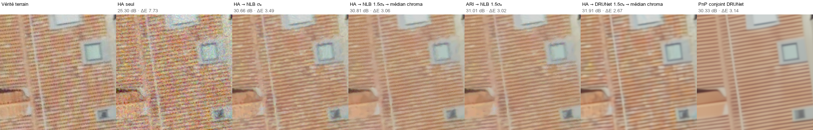
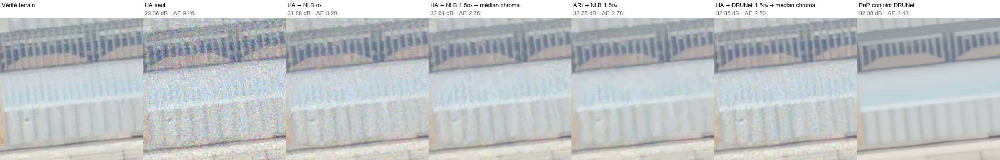

# Démosaïçage et bruit : études

## 11.5 Protocole des études

- **Scène** : extrait 2048×2048 de l'**Orthophotoplan 2024** de Toulouse
  Métropole (secteur du Capitole, 5 cm, août 2024 ; © Toulouse Métropole,
  Licence Ouverte v2.0 Etalab), **supposé sans bruit**, linéarisé par
  l'inverse du gamma sRGB. Quatre zones de 512×512 : *tuiles*,
  *végétation*, *pavés*, *verrière*.
- **Acquisition simulée** : mosaïque RGGB, bruit ``σ² = a + b·L`` avec
  ``a = (2/N)²``, ``b = 1/N`` pour N = 100, 400, 1600 électrons à pleine
  échelle et 2 e⁻ de bruit de lecture (bruit fort, moyen, faible ;
  σ₀ = 0.056, 0.027, 0.013 de la dynamique).
- **Scores** dans l'espace d'affichage (sRGB) : **CPSNR** (dB) et
  **ΔE2000** moyen (erreur de couleur perçue ; < 1 imperceptible,
  2 à 3 visible), moyennes sur les quatre zones.
- **Débruiteurs** : NL-Bayes couleur d'eoqual-denoising (mode Y₀U₀V₀),
  DRUNet couleur de deepinv (poids BSD-3-Clause).

## 11.6 Chaînes démosaïçage + débruitage

`joint_denoising_study.py`. NL-Bayes avec le σ global équivalent σ₀
(ou C·σ₀), sauf « GAT » (stabilisation avec ``(a, b)`` après le
démosaïçage). CPSNR (dB) / ΔE2000 :

| Chaîne | 100 e⁻ (fort) | 400 e⁻ (moyen) | 1600 e⁻ (faible) |
|---|---|---|---|
| HA seul (aucun débruitage) | 24.12 / 8.63 | 30.58 / 4.39 | 34.68 / 2.56 |
| *HA sans bruit (plancher)* | *37.47 / 1.42* | *37.47 / 1.42* | *37.47 / 1.42* |
| *ARI sans bruit (plancher)* | *41.53 / 0.98* | *41.53 / 0.98* | *41.53 / 0.98* |
| **HA → NLB σ₀** (chaîne de départ) | 31.20 / 3.27 | 33.91 / 2.35 | 35.66 / 1.88 |
| HA → NLB 1.5σ₀ (Jin et al.) | 31.62 / 2.97 | 34.00 / 2.22 | 35.49 / 1.83 |
| HA → GAT → NLB 1.5 | 31.67 / 2.97 | 34.13 / 2.20 | 35.68 / 1.80 |
| GAT → NLB (mosaïque) → HA (débruiter d'abord) | 30.26 / 3.44 | 33.14 / 2.55 | 35.38 / 1.98 |
| HA → NLB σ₀ → médian chroma | 31.24 / 3.08 | 34.14 / 2.17 | 36.07 / 1.69 |
| HA → NLB 1.5σ₀ → médian chroma | 31.73 / 2.86 | 34.26 / 2.11 | 35.91 / 1.69 |
| ARI → NLB σ₀ | 31.56 / 3.12 | 35.04 / 2.06 | 37.63 / 1.56 |
| ARI → NLB 1.5σ₀ | 31.84 / 2.87 | 34.86 / 2.03 | 37.31 / 1.58 |
| PnP conjoint, a priori NLB | 31.05 / 3.04 | 33.38 / 2.42 | 34.79 / 2.09 |
| HA → DRUNet 1.5σ₀ | 32.27 / 2.55 | 34.39 / 2.02 | 35.91 / 1.70 |
| HA → DRUNet 1.5σ₀ → médian chroma | 32.30 / 2.53 | 34.47 / 1.99 | 36.09 / 1.64 |
| **ARI → DRUNet 1.5σ₀** | **32.76 / 2.47** | **35.51 / 1.87** | **37.83 / 1.50** |
| PnP conjoint, a priori DRUNet | 31.08 / 2.79 | 34.03 / 2.15 | 35.61 / 1.74 |

« Médian chroma » : médian 3×3 sur R−G et B−G, G inchangé (Freeman
1988). « PnP conjoint » : éclatement semi-quadratique sur
``y = M·x + bruit`` (``M`` : échantillonnage RGGB), attache aux données
pondérée par ``1 / (a·y + b)``, débruiteur couleur comme a priori, niveau
décroissant (λ = 0.1, de 1.7σ₀ à 0.5σ₀, 8 itérations pour NLB ;
λ = 0.23, de 3.4σ₀ à 0.7σ₀, 12 itérations pour DRUNet), à la manière de
FlexISP (Heide et al. 2014).

*Vignettes 160×160 agrandies ×2 (100 e⁻), scores de la zone entière.
Source : Orthophotoplan 2024, © Toulouse Métropole, Licence Ouverte v2.0.
Autre zone : `docs/figures/joint_denoising/vignettes_paves_100e.png`.*

## 11.7 Comparaison des démosaïqueurs : qualité et temps de calcul

`demosaicing_noise_benchmark.py`. Bruit ``σ² = a + b·L``, GAT avec
``(a, b)`` après le démosaïçage, NL-Bayes avec σ = C, **C optimal** de
chaque cas (la règle du [§11.4](modele.md#114-quel-σ-donner-au-débruiteur) en est à 0.1 dB près). Temps : démosaïçage
seul d'une image 2048×2048 (4 Mpx), CPU Apple Silicon, meilleur de deux
passages (NL-Bayes ajoute ≈ 31 s pour 4 Mpx, quel que soit le
démosaïqueur). CPSNR (dB) / ΔE2000, classés par qualité à bruit moyen :

| Méthode | Temps 4 Mpx (s) | vs HA | Sans bruit | 100 e⁻ | 400 e⁻ | 1600 e⁻ | C optimal |
|---|---|---|---|---|---|---|---|
| `ari` | 66.12 | ×137.9 | 41.53 / 0.98 | 31.75 / 3.02 | 35.35 / 1.99 | 37.93 / 1.52 | 1.25/1.25/1.0 |
| `gbtf` | 0.41 | ×0.8 | 39.86 / 1.04 | 32.31 / 2.67 | 35.21 / 1.99 | 37.52 / 1.55 | 1.5/1.5/1.5 |
| `malvar` | 0.14 | ×0.3 | 39.64 / 1.19 | 31.84 / 2.87 | 35.18 / 2.04 | 37.46 / 1.59 | 1.75/1.5/1.5 |
| `mrf` | 2.97 | ×6.2 | 38.90 / 1.38 | 31.96 / 2.87 | 35.10 / 2.16 | 37.11 / 1.76 | 1.5/1.25/1.25 |
| `opencv_vng` | 0.06 | ×0.1 | 40.07 / 1.35 | 23.17 / 5.39 | 35.02 / 2.07 | 37.59 / 1.66 | 1.75/1.25/1.25 |
| `colour_menon2007` | 1.43 | ×3.0 | 40.76 / 1.06 | 31.84 / 2.86 | 34.98 / 2.07 | 37.53 / 1.59 | 1.75/1.5/1.5 |
| `dlmmse` | 0.51 | ×1.1 | 38.76 / 1.32 | 32.07 / 2.71 | 34.81 / 2.08 | 36.83 / 1.72 | 1.75/1.5/1.5 |
| `green_edge_based` | 0.30 | ×0.6 | 37.61 / 1.55 | 31.48 / 3.10 | 34.62 / 2.21 | 36.41 / 1.83 | 1.75/1.75/1.75 |
| `ahd` | 0.32 | ×0.7 | 36.53 / 1.75 | 31.88 / 3.12 | 34.55 / 2.36 | 35.91 / 2.02 | 1.5/1.5/1.75 |
| `ha` | 0.48 | ×1.0 | 37.47 / 1.42 | 31.56 / 3.11 | 34.14 / 2.23 | 35.79 / 1.86 | 1.25/1.25/1.0 |
| `wmlri` | 3.29 | ×6.9 | 36.88 / 1.81 | 31.34 / 3.20 | 34.11 / 2.36 | 35.58 / 2.03 | 1.0/1.0/1.0 |
| `lslcd` | 1.69 | ×3.5 | 35.27 / 1.70 | 31.34 / 3.07 | 34.09 / 2.18 | 35.37 / 1.79 | 1.75/1.75/1.75 |
| `mlri` | 2.03 | ×4.2 | 36.74 / 1.83 | 31.32 / 3.22 | 34.04 / 2.38 | 35.48 / 2.06 | 1.0/1.0/1.0 |
| `ri` | 2.04 | ×4.2 | 36.44 / 1.88 | 31.13 / 3.28 | 33.84 / 2.43 | 35.25 / 2.10 | 1.0/1.0/1.0 |
| `bilinear` | 0.24 | ×0.5 | 35.93 / 1.80 | 30.98 / 3.33 | 33.58 / 2.43 | 34.93 / 2.05 | 1.0/1.0/1.0 |
| `interp_spline` | 0.76 | ×1.6 | 34.24 / 1.54 | 29.82 / 3.49 | 32.47 / 2.40 | 33.55 / 2.07 | 0.75/0.75/0.5 |
| `opencv_ea` | 0.03 | ×0.1 | 35.81 / 2.02 | 22.32 / 6.82 | 32.26 / 2.62 | 34.81 / 2.21 | 1.75/1.0/1.0 |
| `interp_bicubic` | 0.58 | ×1.2 | 31.05 / 1.84 | 28.82 / 3.65 | 30.36 / 2.61 | 30.83 / 2.16 | 0.5/0.5/0.5 |
| `interp_bilinear` | 0.56 | ×1.2 | 30.07 / 2.11 | 28.46 / 3.59 | 29.66 / 2.69 | 29.97 / 2.33 | 0.5/0.5/0.5 |

Méthodes évaluées sans bruit seulement :

| Méthode | Temps 4 Mpx (s) | vs HA | Sans bruit | Raison |
|---|---|---|---|---|
| `opencv_bilinear` | 0.03 | ×0.1 | 35.86 / 1.80 | même noyau que `bilinear` (κ identiques), bords différents |
| `colour_bilinear` | 0.14 | ×0.3 | 34.00 / 1.91 | même noyau que `bilinear` (κ identiques), bords différents |
| `colour_malvar2004` | 0.27 | ×0.6 | 39.64 / 1.19 | même résultat que `malvar` |
| `malvar_bilateral` | 185.52 | ×387 | 37.21 / 2.10 | trop lent pour l'évaluation avec bruit |
| `edge_aware` | 316.18 | ×659 | 31.03 / 3.78 | trop lent pour l'évaluation avec bruit |
| `edge_aware_simplified` | 91.86 | ×192 | 33.81 / 2.48 | trop lent pour l'évaluation avec bruit |
| `cdm` | 1939.84 | ×4046 | 30.91 / 3.72 | trop lent pour l'évaluation avec bruit |

Lecture :

- **`gbtf`** (Pekkucuksen & Altunbasak 2010) est le meilleur compromis :
  **aussi rapide que HA** (0.41 s contre 0.48 s), meilleur à tous les
  niveaux de bruit (+0.75 / +1.07 / +1.73 dB à C optimal, ΔE −11 à −16 %),
  meilleur que tout le catalogue à bruit fort.
- **`ari`** est le meilleur à bruit moyen et faible (+1.2 / +2.1 dB sur
  HA) et sans bruit (41.5 dB), mais **138 fois plus lent** (66 s pour
  4 Mpx) et pas meilleur que GBTF à bruit fort.
- **`malvar`** est le plus rapide des bons (0.14 s, 3 fois plus rapide
  que HA), à 0.1 à 0.5 dB de GBTF.
- `mrf`, `colour_menon2007`, `opencv_vng`, `dlmmse` : intermédiaires ;
  **`opencv_vng` et `opencv_ea` s'effondrent à bruit fort** (22 à 23 dB) :
  leurs décisions de direction sont piégées par le bruit.
- Les interpolations séparables (`interp_*`, `bilinear`) et les méthodes
  lentes sans gain (`cdm`, `edge_aware*`) ne sont pas à retenir ici.

## 11.8 Ce que les études confirment, nuancent ou contredisent

1. **Débruiter après démosaïquer — confirmé.** Débruiter la mosaïque
   d'abord perd 0.3 à 0.9 dB : la demi-résolution des quatre sous-plans
   perd les détails fins.
2. **Majorer σ — confirmé et précisé.** Le bon facteur n'est pas 1.5 en
   général mais **√κ_Y + 0.2**, propre à chaque démosaïqueur (1.36 pour
   HA, 1.75 pour GBTF, 1.0 à 1.25 pour la famille RI) ; il est aussi
   plus fort pour DRUNet (1.5 à 1.75 avec HA).
3. **Le démosaïqueur compte — contredit.** L'article trouve des écarts
   négligeables une fois σ adapté, à bruit fort. Ici, à bruit moyen et
   faible, l'écart atteint 2 dB : une part des défauts de la chaîne de
   départ vient de HA lui-même (plancher 37.5 dB, ΔE 1.42), dont les
   fausses couleurs sur les contours survivent au débruitage.
4. **Le médian chroma** corrige surtout les fausses couleurs de
   démosaïçage (sans bruit : +0.7 dB pour HA, +4.3 à +4.5 dB pour RI et
   MLRI, rien pour ARI) ; après débruitage, 0 à 0.4 dB. Taille 3×3 (un
   médian 5×5 dégrade la végétation).
5. **La stabilisation de variance** gagne 0.05 à 0.2 dB sur le σ global
   équivalent dans cette plage de flux ; davantage attendu sur une scène
   à fort contraste (ombres profondes et zones claires).
6. **Le Plug-and-Play conjoint ne gagne pas** (0.2 à 0.9 dB sous la
   chaîne séquentielle NL-Bayes, 1.5 à 2.2 dB sous ARI → DRUNet) et
   aplatit les textures ; comme JCNN dans l'article, l'approche conjointe
   n'est pas la priorité.
