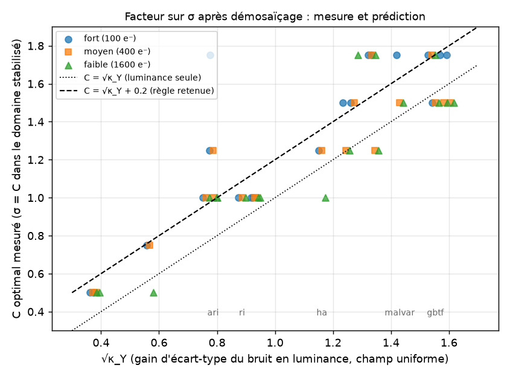

# Démosaïçage et bruit : modèle et choix de σ

## 11.1 Ce que dit la littérature : Jin, Facciolo & Morel (2020)

Q. Jin, G. Facciolo, J.-M. Morel, « A Review of an Old Dilemma:
Demosaicking First, or Denoising First? », CVPR Workshops 2020
(arXiv 2004.11577).

- **Protocole** : bruit blanc gaussien ajouté à la mosaïque (σ₀ de 1 à
  60 sur 255), bases Imax et Kodak, 14 images brutes réelles SIDD (bruit
  blanchi par racine carrée) ; démosaïçage HA, GBTF, RI, MLRI, ARI, LSSC,
  RCNN ; débruitage CBM3D et nlBayes, adaptés à la mosaïque pour l'ordre
  « débruiter d'abord » (BM3D-CFA, ou image à 4 canaux en demi-résolution).
- **Bruit démosaïqué** : le démosaïçage concentre le bruit dans la
  luminance Y et le réduit en chrominance U, V, où il devient fortement
  corrélé spatialement — un bruit de basse fréquence. Les trois canaux
  sont corrélés (0.6 à 0.9).
- **Conclusion** : démosaïquer d'abord, puis débruiter avec un niveau de
  bruit **majoré**, ``σ = 1.5 σ₀`` (« DM&1.5DN »), justifié par la
  variance accrue de Y (facteur √3 ≈ 1.7 si les canaux étaient
  parfaitement corrélés). Pour HA + nlBayes à σ₀ = 20 : 28.17 dB
  (débruiter d'abord), 28.67 dB (σ = σ₀), **29.29 dB** (σ = 1.5 σ₀). Le
  réseau conjoint JCNN (Gharbi et al. 2016) ne fait guère mieux.

## 11.2 Modèle physique du bruit du capteur

**Physique.** Un photosite convertit un nombre aléatoire de photons en
photo-électrons ; ce comptage suit une loi de **Poisson** (bruit
photonique, ou de grenaille) : si ``λ`` électrons sont attendus, la
variance vaut aussi ``λ``. La chaîne de lecture ajoute un bruit
**gaussien** indépendant du signal (électronique de lecture,
quantification, courant d'obscurité), d'écart-type ``σ_r`` électrons.
La conversion en comptes numériques divise par le gain ``K`` (e⁻/DN).
Après soustraction du niveau d'obscurité et normalisation par la pleine
échelle ``S_max`` (DN), la luminance linéaire ``L ∈ [0, 1]`` d'un pixel
vérifie :

```
E[L] = λ / N_sat            avec N_sat = K · S_max  (électrons à pleine échelle)
var(L) = λ / N_sat² + σ_r² / N_sat²
       = a + b · L,          a = (σ_r / N_sat)²,   b = 1 / N_sat
```

- ``a`` est le **plancher** (bruit de lecture et d'obscurité, présent
  même dans le noir) ; un bruit stationnaire de variance σ² s'écrit
  a = σ², b = 0 ;
- ``b`` est la **pente** (bruit photonique, l'inverse du nombre
  d'électrons à pleine échelle) ;
- le bruit est **indépendant d'un photosite à l'autre** (pas de
  diaphonie) : spatialement blanc, mais **non stationnaire**, puisque
  son écart-type ``σ(L) = √(a + b·L)`` dépend de la luminance de chaque
  pixel.

C'est la droite de la courbe photon-transfert (PTC), avec les lettres
d'eoqual-measure (``σ² = a + b·μ``, ``a`` plancher, ``b`` pente) : ``a``
et ``b`` se mesurent par sa PTC et s'utilisent tels quels, ou s'estiment
sur l'image. Convention commune aux modules EOQual ; une partie de la
littérature note ``σ² = a·L + b``, lettres inversées (Foi et al., 2008).

**Théorie « en σ ».** Tout ce qui suit raisonne avec un écart-type, mais
un écart-type **fonction de la luminance**, ``σ(L) = √(a + b·L)``, et non
un σ unique. Deux façons de le donner à un débruiteur conçu pour un σ
unique :

- **stabilisation de variance** (transformée d'Anscombe généralisée,
  GAT) : ``f(L) = (2/b) · √(b·L + 3b²/8 + a)``. Par la méthode delta,
  ``var(f(L)) ≈ f'(L)² · var(L) = (a + b·L) / (a + b·L + 3b²/8) ≈ 1`` :
  le bruit devient d'écart-type **1, partout**. On débruite avec σ = 1
  (ou C, voir §11.4), puis on applique l'inverse exacte non biaisée
  (Mäkitalo & Foi 2013). Dans eoqual-denoising :
  ``generalized_anscombe(L, gain=1/b, read_noise_dn=√a)`` ;
- **σ global équivalent** : ``σ₀ = √(a + b·L̄)`` (valeur quadratique
  moyenne sur l'image). Plus simple, mais trop fort dans les zones
  sombres et trop faible dans les zones claires.

## 11.3 Ce que le démosaïçage fait du bruit

**Modèle linéaire local.** Autour d'un pixel ``p``, un démosaïqueur
estime chaque canal ``c`` comme une combinaison des valeurs voisines de
la mosaïque, ``x̂_c(p) = Σ_q w_{c,p}(q) · y(q)``, avec ``Σ_q w = 1`` (une
zone uniforme reste uniforme). Les méthodes adaptatives (HA, ARI...)
choisissent ces poids selon les données ; le modèle reste valable
localement. Le bruit de sortie est la même combinaison des bruits
d'entrée, indépendants :

```
var ε̂_c(p)            = Σ_q w_{c,p}(q)² · σ²(L_q)  ≈  σ²(L_p) · Σ_q w_{c,p}(q)²     (zone homogène)
cov(ε̂_c(p), ε̂_c'(p')) = Σ_q w_{c,p}(q) · w_{c',p'}(q) · σ²(L_q)
```

Trois conséquences :

1. **Chaque canal est moins bruité** qu'un photosite : ``Σ w² ≤ 1``
   quand ``Σ w = 1`` (moyenne de plusieurs mesures) ; l'égalité n'a lieu
   qu'au pixel mesuré.
2. **Le bruit devient corrélé** entre pixels voisins et entre canaux :
   des poids partagés (``w_{c,p}`` et ``w_{c',p'}`` utilisent les mêmes
   photosites) créent des covariances.
3. **La structure couleur change.** Dans la base orthonormée
   ``Y = (R+G+B)/√3``, ``U = (R−G)/√2``, ``V = (R+G−2B)/√6``, la
   variance de Y est ``(1/3) Σ_{c,c'} cov(ε̂_c, ε̂_c')`` : des canaux
   corrélés positivement l'**augmentent** (jusqu'à ×3 si les trois canaux
   étaient identiques), tandis que U et V, faits de différences, la
   **diminuent** — mais ce qui reste en U, V est de basse fréquence (taches
   colorées).

On note ``κ_Y, κ_U, κ_V`` le rapport des variances après / avant
démosaïçage. Le modèle de bruit devient, en zone homogène,
``var_Y(L) ≈ κ_Y · (a + b·L)`` : la forme affine est conservée, avec un
coefficient propre à chaque démosaïqueur. Mesure (`demosaicing_noise_benchmark.py`) :
bruit blanc σ = 20/255 sur une mosaïque uniforme (L = 0.5), corrélation
avec le voisin horizontal :

| Méthode | κ_Y | κ_U | κ_V | corr. Y | corr. U | √κ_Y | C = √κ_Y + 0.2 |
|---|---|---|---|---|---|---|---|
| `interp_bilinear` | 0.14 | 0.13 | 0.16 | 0.80 | 0.80 | 0.37 | 0.57 |
| `interp_bicubic` | 0.15 | 0.13 | 0.17 | 0.85 | 0.85 | 0.38 | 0.58 |
| `interp_spline` | 0.32 | 0.31 | 0.34 | 0.68 | 0.66 | 0.57 | 0.77 |
| `colour_bilinear` | 0.58 | 0.59 | 0.58 | 0.57 | 0.53 | 0.76 | 0.96 |
| `bilinear` | 0.58 | 0.59 | 0.58 | 0.57 | 0.53 | 0.76 | 0.96 |
| `opencv_bilinear` | 0.58 | 0.59 | 0.58 | 0.57 | 0.53 | 0.76 | 0.96 |
| `ari` | 0.62 | 0.62 | 0.64 | 0.52 | 0.51 | 0.79 | 0.99 |
| `opencv_ea` | 0.62 | 0.66 | 0.60 | 0.53 | 0.48 | 0.79 | 0.99 |
| `edge_aware_simplified` | 0.72 | 0.77 | 0.69 | 0.39 | 0.31 | 0.85 | 1.05 |
| `edge_aware` | 0.73 | 0.80 | 0.66 | 0.06 | -0.03 | 0.85 | 1.05 |
| `ri` | 0.79 | 0.52 | 0.55 | 0.48 | 0.45 | 0.89 | 1.09 |
| `mlri` | 0.87 | 0.46 | 0.50 | 0.44 | 0.49 | 0.93 | 1.13 |
| `wmlri` | 0.88 | 0.45 | 0.49 | 0.43 | 0.48 | 0.94 | 1.14 |
| `cdm` | 1.04 | 0.58 | 0.69 | 0.17 | 0.22 | 1.02 | 1.22 |
| `malvar_bilateral` | 1.29 | 0.22 | 0.24 | 0.21 | 0.51 | 1.14 | 1.34 |
| `ha` | 1.35 | 0.40 | 0.46 | 0.29 | 0.60 | 1.16 | 1.36 |
| `mrf` | 1.55 | 0.29 | 0.41 | 0.29 | 0.64 | 1.25 | 1.45 |
| `ahd` | 1.62 | 0.38 | 0.55 | 0.29 | 0.69 | 1.27 | 1.47 |
| `green_edge_based` | 1.78 | 0.43 | 0.63 | 0.24 | 0.69 | 1.33 | 1.53 |
| `opencv_vng` | 1.81 | 0.22 | 0.26 | 0.18 | 0.73 | 1.34 | 1.54 |
| `colour_malvar2004` | 2.05 | 0.33 | 0.38 | 0.26 | 0.68 | 1.43 | 1.63 |
| `malvar` | 2.05 | 0.33 | 0.38 | 0.26 | 0.68 | 1.43 | 1.63 |
| `lslcd` | 2.37 | 0.30 | 0.36 | 0.11 | 0.78 | 1.54 | 1.74 |
| `gbtf` | 2.41 | 0.11 | 0.14 | 0.13 | 0.85 | 1.55 | 1.75 |
| `colour_menon2007` | 2.50 | 0.20 | 0.26 | 0.11 | 0.80 | 1.58 | 1.78 |
| `dlmmse` | 2.58 | 0.06 | 0.09 | 0.09 | 0.85 | 1.60 | 1.80 |

Lecture : les interpolations séparables (bilinéaire, bicubique) lissent
le bruit (κ ≈ 0.15, très corrélé) ; les méthodes directionnelles et à
différences de couleur (HA, AHD, Malvar, GBTF, DLMMSE) concentrent le
bruit en luminance (κ_Y de 1.35 à 2.6) et laissent une chrominance faible
mais très corrélée (0.6 à 0.85). Les méthodes à **filtrage guidé
adaptatif** (RI, MLRI, ARI) lissent fortement un champ uniforme
(κ_Y ≈ 0.6 à 0.9) ; sur une scène texturée elles transmettent davantage
de bruit, si bien que leur κ mesuré sur champ uniforme est un minorant —
d'où l'écart avec Jin et al., qui mesurent sur du bruit pur (κ_Y ≈ 1.8
pour RI).

## 11.4 Quel σ donner au débruiteur

Les débruiteurs couleur (NL-Bayes en mode Y₀U₀V₀, CBM3D) passent en
luminance/chrominance et règlent leur étape principale sur le niveau de
bruit de **Y**. Après démosaïçage, celui-ci vaut ``√κ_Y · σ(L)`` :

1. **stabiliser** l'image démosaïquée avec les paramètres du capteur
   ``(a, b)`` — le bruit vaut alors ``√κ_c`` (et non 1) dans le domaine
   stabilisé ;
2. **débruiter avec σ = C**, ``C = √κ_Y + 0.2`` ;
3. **inverser** la stabilisation.

Sans stabilisation, donner ``σ = C · σ₀`` avec ``σ₀ = √(a + b·L̄)``.

Le terme ``√κ_Y`` vient de la théorie (luminance) ; le **+0.2** est
empirique : il compense le bruit de chrominance basse fréquence, que le
débruiteur voit comme du signal, et que seul un σ un peu plus fort
efface. Validation sur 19 démosaïqueurs × 3 niveaux de bruit × 4 zones
([§11.7](etudes.md#117-comparaison-des-démosaïqueurs--qualité-et-temps-de-calcul)), C balayé de 0.5 à 1.75 : corrélation de 0.88 entre l'optimum
mesuré et √κ_Y, et perte par rapport à l'optimum de chaque cas :

| Règle | bruit fort (100 e⁻) | moyen (400 e⁻) | faible (1600 e⁻) |
|---|---|---|---|
| C = 1 (σ du capteur, sans majoration) | 1.12 dB (max 3.44) | 0.47 (max 1.48) | 0.22 (max 1.14) |
| C = 1.25 fixe | 0.63 (max 2.25) | 0.20 (max 0.57) | 0.13 (max 0.74) |
| C = 1.5 fixe (Jin et al.) | 0.31 (max 1.16) | 0.18 (max 0.78) | 0.15 (max 0.53) |
| C = √κ_Y | 0.33 (max 1.19) | 0.11 (max 0.65) | 0.06 (max 0.25) |
| **C = √κ_Y + 0.2** | **0.08 (max 0.39)** | **0.04 (max 0.16)** | **0.05 (max 0.22)** |



*Points sur la grille 0.5 à 1.75 (les optima à 1.75 peuvent être plus
hauts). Pour HA, √κ_Y + 0.2 = 1.36 ; le facteur 1.5 de Jin et al.
correspond à un démosaïqueur de κ_Y ≈ 1.7 (RI sur bruit pur, dans leur
mesure).*

**Piège : estimer σ après le démosaïçage.** L'estimateur usuel
(Donoho-Johnstone : médiane de la sous-bande d'ondelettes diagonale la
plus fine) ne voit que les hautes fréquences du bruit, que le démosaïçage
a atténuées. Mesure, zone « tuiles » :

| | σ₀ vrai | estimé après HA | estimé sur les 4 sous-plans de la mosaïque |
|---|---|---|---|
| 100 e⁻ | 0.061 | 0.031 (×0.50) | 0.061 (×1.00) |
| 400 e⁻ | 0.029 | 0.016 (×0.56) | 0.034 (×1.15) |

Un σ estimé après HA vaut la **moitié** du vrai : NL-Bayes sous-débruite
et laisse des taches colorées (28.2 dB / ΔE 5.5 contre 30.9 dB / ΔE 3.3
avec le σ de la mosaïque majoré de 25 %, à 100 e⁻). Le σ — ou ``(a, b)``
— se mesure **sur la mosaïque** (sous-plans R, G1, G2, B, où le bruit est
encore blanc) ou sur le capteur (PTC).
